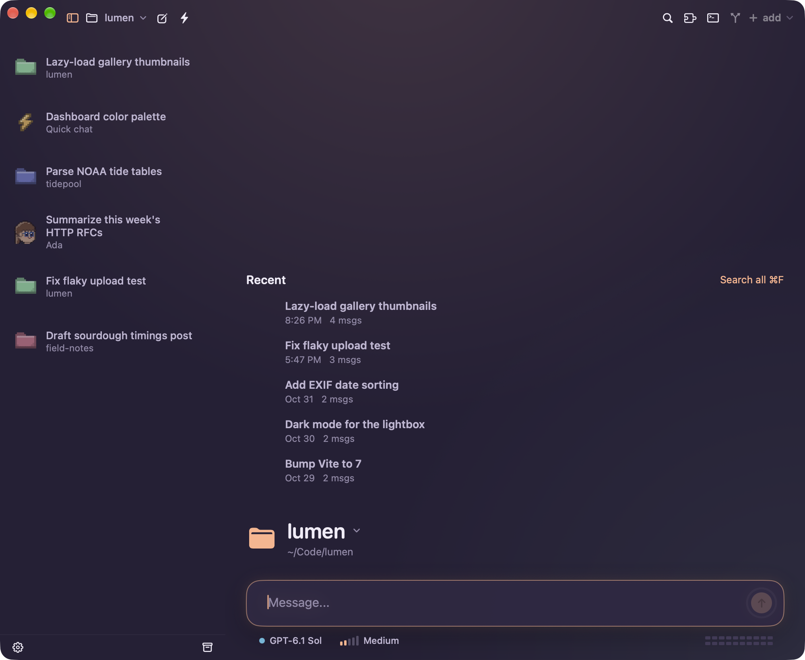
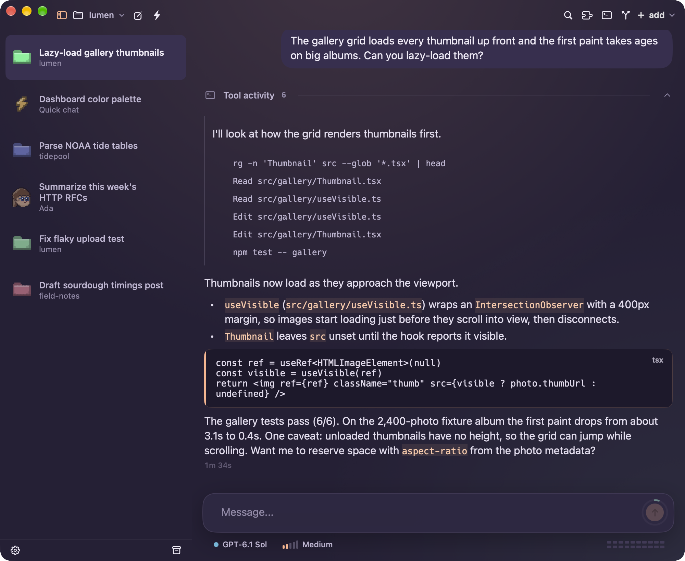
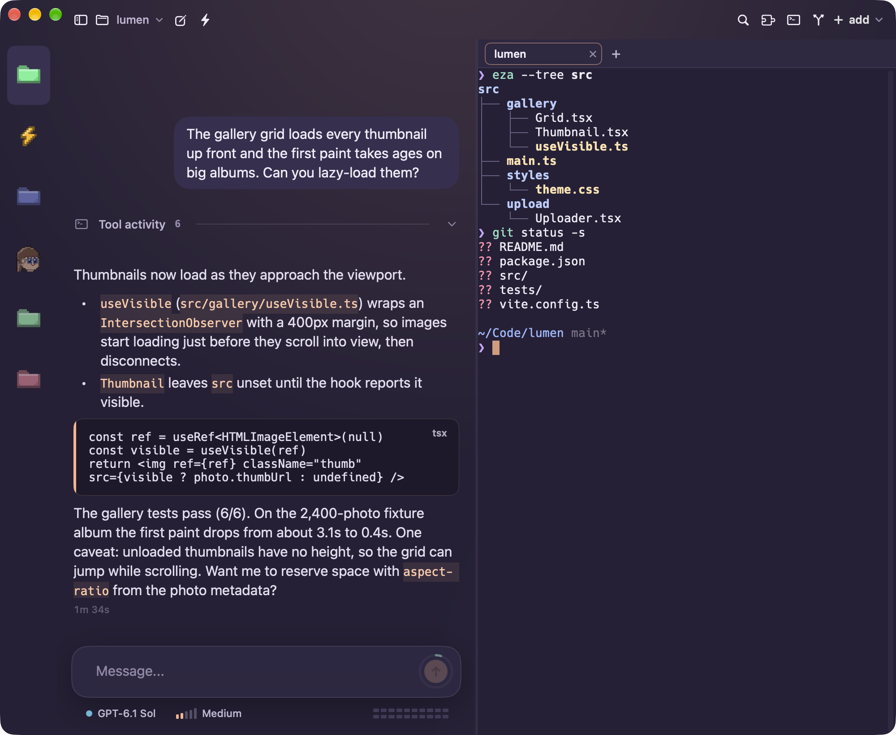
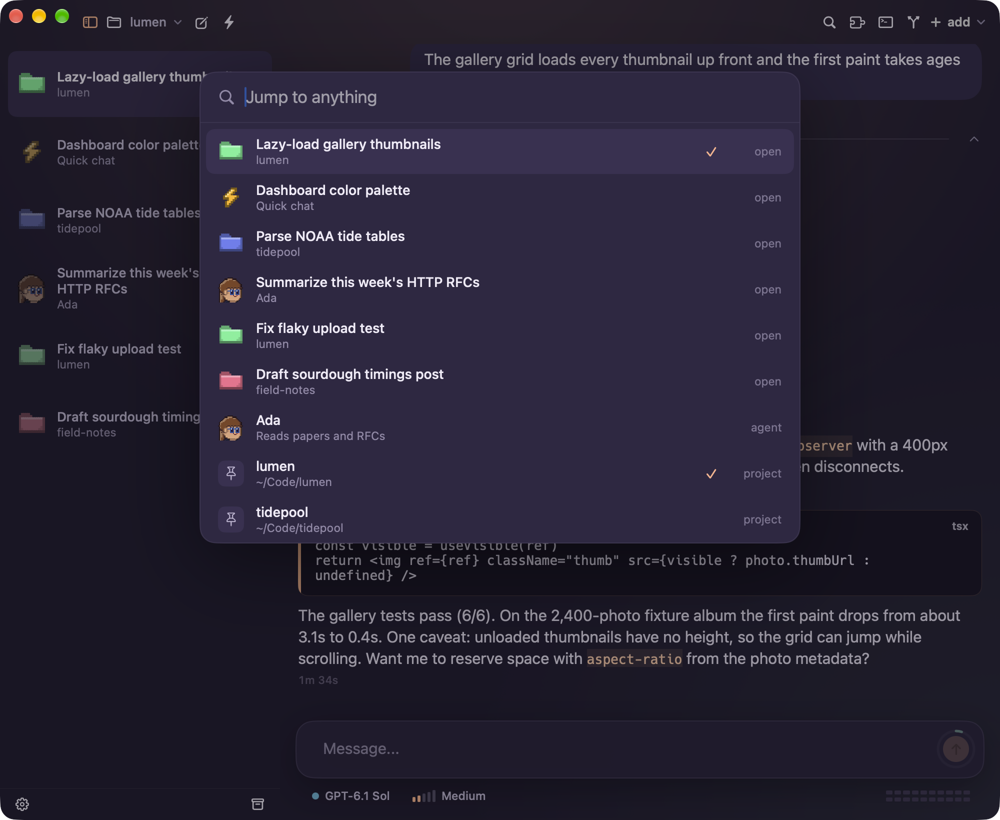
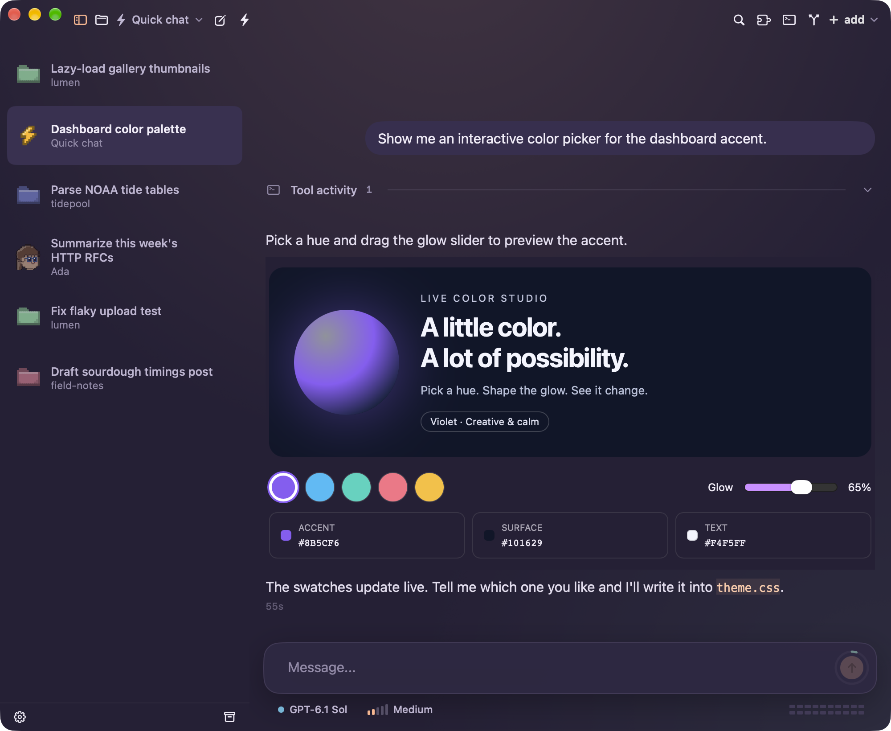

# PiG

<p>
  
  
</p>
<p>
  
  
</p>

PiG is a SwiftUI macOS GUI for the `pi` coding agent.

## Requirements

- macOS 14+ and a Swift toolchain (Xcode or compatible Swift installation)
- `pi` installed

## Features

### Projects & sessions

- Open chats in a list on the left with a pixel folder per project (or the agent's face), title, and status; swipe to mark done, drag to reorder, ⌘S to hide
- Collapse the open-chats list to an icon rail for more room
- ⌘K palette for open chats, all sessions (including the archive), agents, projects, files, models, and actions; use ↑/↓ or Ctrl-P/Ctrl-N to move through results
- Project files in a popover from the top bar
- Project home page listing recent sessions
- Quick Chats: throwaway chats that don't belong to a project
- Session names generated automatically (by the session's model, a model you pick, or Apple Intelligence on the Mac); “Rename with AI” generates a new title from the opening conversation turns
- Session tree view: jump to any earlier point in a conversation and fork a new session from a prompt
- Search across all sessions, including archived ones (⌘F)
- Several sessions can run at once; idle ones can be unloaded or reloaded
- macOS notification when a reply finishes while you're in another app

### Agents & Hermes

- Create reusable pi agents with your choice of model, extensions, and skills. Selected skills are automatically included in context for every chat.
- Connect local or remote Hermes agents and chat with them in PiG.
- Switch between agents and projects in the picker; agent chats show the agent's face in the open-chats list.

### Chat & composer

- Markdown rendering with syntax-highlighted code previews
- Tool activity groups that expand to show commands and file reads
- Background jobs stay visible while running, with results linked back to the tool call
- Detailed views of subagent runs
- Optional display of the model's thinking traces
- Attach images by pasting or dragging
- `@` completion for files and skills, and slash-command suggestions
- Queue steering and follow-up messages while the agent works (Option-Up returns queued messages to the composer)
- Context use shown as a ring around the send button; thinking level as rising bars you click to step
- Claude subscription usage for `claude-bridge`, updated when Claude Code reports quota data (no separate Pi OAuth login required)

### Inline HTML controls



The agent can add interactive controls directly to its replies—sliders, color
pickers, counters, and more—styled to match your theme.

Try asking: **“Show me an interactive color picker.”**

Controls run in a sandbox without network or local-file access. Buttons can
send a predefined message to the agent after you confirm it. Right-click to
view, copy, or save the HTML. Control state resets when you reload or reopen
the chat.

### Models

- Model and thinking-level pickers for each session
- Quick Model shortcuts (⌘1–⌘5)
- Default model and thinking level for new sessions
- A schedule that picks the default model by time of day and work days
- Usage-limit meters for ChatGPT/Codex, Claude and Grok, shown only when you have credentials for that provider

### pi integration

- Extensions & Resources popover for turning extensions and skills on or off per chat
- Support for extension UI: prompts (select, confirm, input, editor), notifications, status items, widgets, window title
- Pi updates: check for them, update pi and its extensions, and a "What's New" view

### Workspace

- File tree: create, rename and trash files; reveal in Finder; open in Terminal; copy paths and references
- Custom actions: a button in the title bar that runs your saved shell commands for the project, with output shown in the chat
- Built-in terminal ([SwiftTerm](https://github.com/migueldeicaza/SwiftTerm)): [fullscreen](images/pig-fullscreen-terminal.png) (⌘⇧F), vertical split (⌘D) or horizontal split (⌘⇧D), with tabs; opens in the session's project folder

### Appearance

- Themes including Dusk (the default), Finder Blue, Nord, Dracula, Tokyo Night Storm, Rosé Pine and GitHub Light; Glow versions of Finder Blue, Nord, Tokyo Night Storm and Rosé Pine
- Adjustable text size (⌘+ / ⌘−)
- Native SwiftUI app for macOS 14+

## Download

Download the Apple silicon app from [Releases](https://github.com/jmcblane/PiG/releases). It isn't notarized, so you may need to allow it in System Settings → Privacy & Security after the first launch attempt.

Check for updates from PiG → Check for Updates…

## Build

```sh
scripts/build-app.sh
open dist/PiG.app
```

Requires macOS 14+ and a Swift toolchain. Add `--clean` for a clean build; optional signing settings are documented in `scripts/build-app.local.env.example`.

If PiG can't find `pi`, set its path in Settings → General.

For a separate demo app with fake projects, chats, and an agent:

```sh
scripts/build-demo.sh
open .demo/PiG.app
```

The demo uses its own app preferences and data in `.demo/` (gitignored), without
copying credentials or reading your chat history. Rebuilds preserve demo data;
quit the demo and move `.demo/home` to the Trash to seed fresh chats next time.
Requires Python 3 in addition to the build requirements above.

Third-party licenses are in `THIRD_PARTY_NOTICES.md`.
